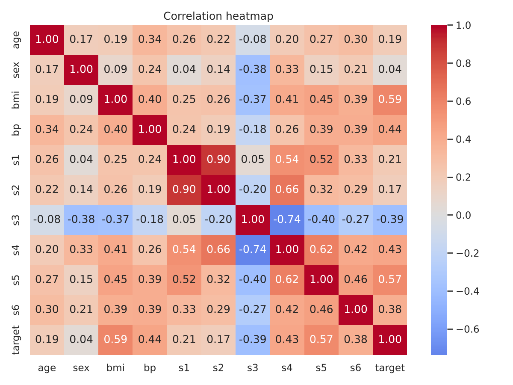
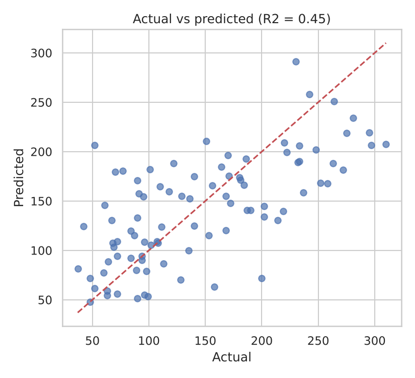
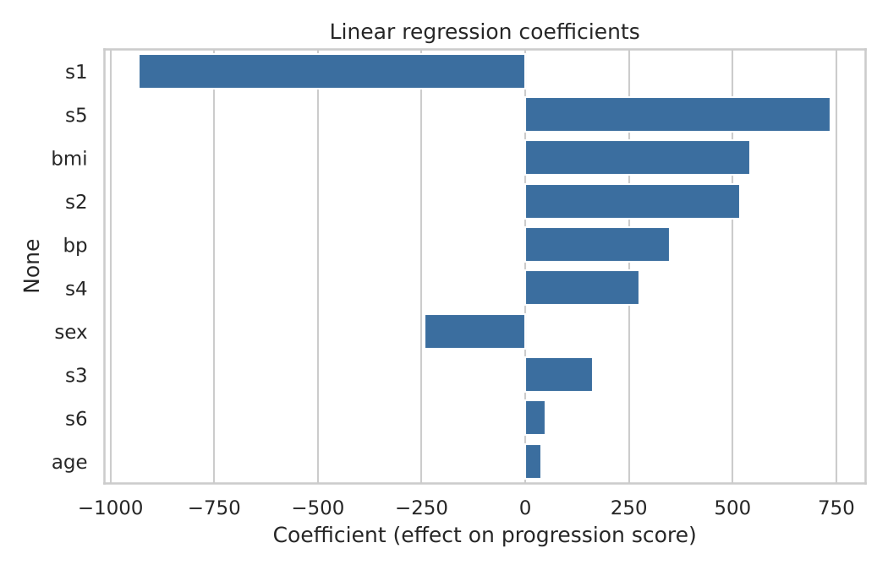

# Linear Regression: Diabetes Disease Progression

A beginner-friendly machine learning project that predicts how much a patient's diabetes progresses one year after baseline, using **simple linear regression modelling in Python**.

**Dataset:** scikit-learn's built-in Diabetes dataset (442 patients, 10 baseline features: age, sex, BMI, blood pressure and 6 blood serum measurements). It ships with scikit-learn, so no download is needed.

## What this project does
1. Loads and checks the data (rows, missing values, summary statistics).
2. EDA: target distribution and a correlation heatmap.
3. Splits the data 80/20 and trains a `LinearRegression` model.
4. Evaluates it with R2, RMSE, MAE and 5-fold cross-validation, and compares RMSE with a "predict the average" baseline.
5. Plots coefficients, actual vs predicted values and residuals.

## How to run
```bash
git clone https://github.com/Vineet79-web/linear-regression-diabetes.git
cd linear-regression-diabetes
pip install -r requirements.txt
python linear_regression.py
```
Outputs are saved in `outputs/` (`metrics.json`, `coefficients.csv`, `figures/`).

## Results
| Metric | Value |
|---|---|
| Test R2 (89 patients) | 0.453 |
| 5-fold cross-validated R2 | 0.482 (+/- 0.049) |
| Test RMSE | 53.85 |
| Baseline RMSE (always predict the mean) | 73.22 |

- The model cuts prediction error by about **26%** compared with the baseline.
- **BMI** (correlation 0.59) and **s5, a serum triglycerides measure** (0.57) have the strongest link with progression; **blood pressure** is next (0.44).
- Test R2 of about 0.45 means the model explains under half of the variation. A simple linear model is a good first baseline, and the next step would be regularised or non-linear models.
- Features `s1` and `s2` are highly correlated with each other, which makes their individual coefficients large and opposite in sign (multicollinearity). Do not read them as separate effects.

## Charts




## Tech stack
Python, Pandas, NumPy, Scikit-learn, Matplotlib, Seaborn

## Next steps
- Try Ridge/Lasso regression to handle multicollinearity.
- Try Random Forest and compare R2.
- Build a small Streamlit app for predictions.
